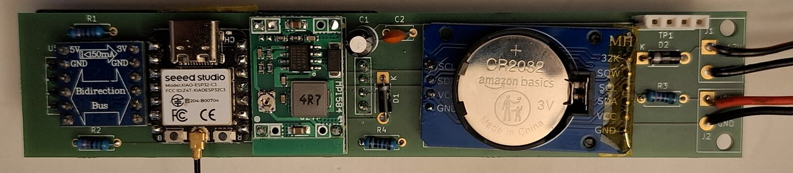
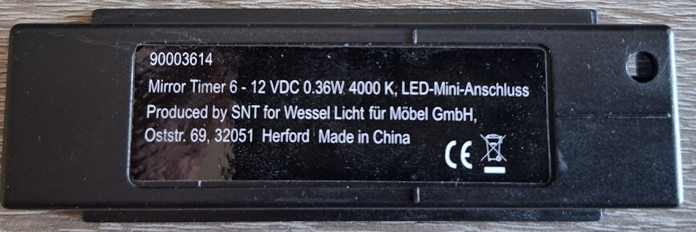
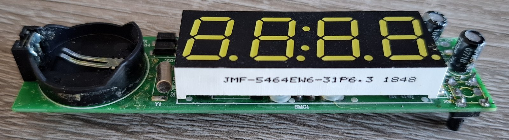
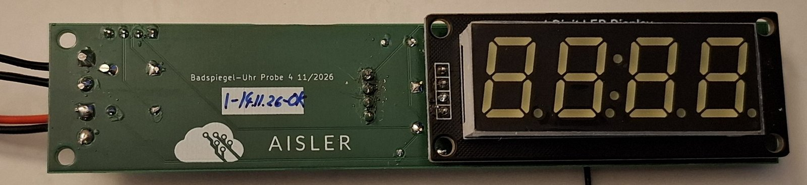
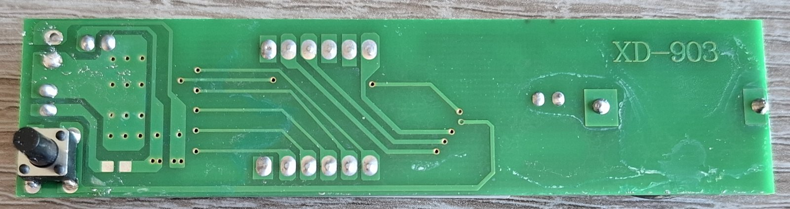
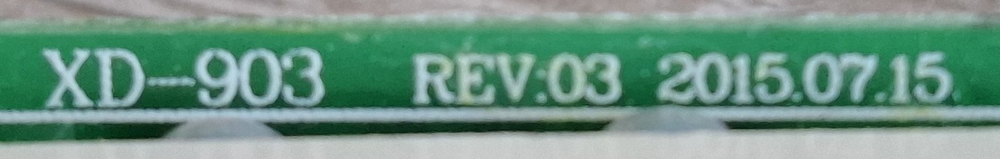

# Badspiegel-Uhr auf ESP32 (Ersatz für „Mirror Timer 90003614“)

**English summary:** Drop-in replacement for the clock insert of a bathroom mirror cabinet. The original
module is labelled "Mirror Timer 90003614, 6 - 12 VDC 0.36W, produced by SNT for Wessel Licht für Möbel GmbH"
(PCB "XD-903 REV.03"). It lost the time after every power cut. This replacement uses a Seeed XIAO
ESP32-C3 with ESPHome, a DS3231 real-time clock with coin cell and a white TM1637 4-digit display. It gets
the time over Wi-Fi, keeps it without power, dims itself by sun position and can show the outdoor temperature
from Home Assistant. It fits the original rail and uses the original 12 V and push-button cables. Note:
the new housing is longer (141.9 mm instead of 96.8 mm) and deeper (27.9 mm instead of 17.5 mm) than the
original. It fits my mirrors (30 mm gap behind the slot), other mirrors are untested. The
repository contains the ESPHome configuration, a two-layer KiCad board (Gerber files with and without the
Aisler logo placeholder) and an OpenSCAD housing with ready-to-print STL and 3MF files. Documentation is in German.
Licence: CC BY-NC-SA 4.0 (no commercial use).

Stichworte: Badspiegel Uhr Ersatz, Spiegelschrank Uhr geht nach, Spiegeluhr verliert Zeit, Uhrmodul
Badspiegel, Wessel Licht, XD-903, XD-904, XiongDa, mirror clock module, bathroom mirror clock replacement,
ESPHome, Home Assistant.

> Dieses Projekt ist nicht mit Wessel Licht für Möbel GmbH oder dem Hersteller des Spiegels verbunden.
> Die Namen stehen hier nur, damit man das passende Original erkennt.



## Worum es geht

Im Spiegelschrank steckt hinter einer milchigen Scheibe eine kleine Uhr in einer Schiene. Die Uhr bekommt
nur Strom, wenn das Licht am Spiegel an ist. Eine Knopfzelle soll die Zeit halten, wenn das Licht aus ist.
Bei diesem Modul klappt das nicht: Die Uhr geht falsch, auch mit neuer Knopfzelle. Stellen kann man sie nur
mühsam mit einem kleinen Knopf unter dem Spiegel.

Die neue Uhr passt in dieselbe Schiene und stellt sich selbst. Sie ist aber länger und tiefer als das
Original (Abschnitt „Das Gehäuse“).

## So erkennst du das Original

- Schild auf der Rückseite: „90003614 / Mirror Timer 6 - 12 VDC 0.36W 4000 K, LED-Mini-Anschluss“.
- Aufdruck auf der Platine: „XD-903 REV.03 2015.07.15“. Händler nennen als Hersteller XiongDa. Ein
  ähnliches Modul heißt XD-904. Ob es in dieselbe Schiene passt, habe ich nicht geprüft.
- Gelbe Ziffern, Knopfzelle CR2032.
- Gehäuse außen 96,8 × 27,0 × 17,5 mm, mit zwei Flügeln für die Schiene.
- Zwei Kabelpaare: Strom (12 V) und ein Knopf (kleiner Joystick unter dem Spiegel).





## Was die neue Uhr kann

- **Sie stellt sich selbst.** Sie holt die genaue Zeit über das WLAN aus dem Internet.
- **Sie vergisst die Zeit nicht.** Ein Uhrmodul mit Knopfzelle zählt weiter, wenn das Licht aus ist.
- **Sie ist sofort da.** Nach dem Einschalten des Lichts steht die Uhrzeit nach 1 bis 3 Sekunden. Sie
  kommt direkt aus dem Uhrmodul und wartet nicht auf das WLAN.
- **Sie braucht wenig Strom.** Etwa 0,13 W statt 0,36 W beim Original, also rund ein Drittel.
- **Sie dimmt sich selbst.** Sie rechnet aus, ob die Sonne schon untergegangen ist, und leuchtet nachts
  schwächer. Dafür braucht sie keine weitere Technik.
- **Morgen-Briefing (nur mit Home Assistant):** Morgens zeigt sie abwechselnd die Uhrzeit, die
  Außentemperatur, die Höchsttemperatur des Tages und die Regenmenge.
- **Der Knopf unter dem Spiegel:** kurz drücken zeigt die Werte einmal. Lang drücken (1 bis 5 Sekunden)
  schaltet das Morgen-Briefing an oder aus.

Home Assistant ist eine Software für das eigene Zuhause. Ohne Home Assistant läuft die Uhr auch, dann
nur ohne Morgen-Briefing.

## Sicherheit

> **WARNUNG:** Hinter dem Spiegel liegt ein Netzteil an 230 V. Öffne das Netzteil nicht. Arbeite nur an
> den Kabeln im Einschubschacht der Uhr. Dort liegen nur 12 V. Wenn du an das Netzteil musst, schalte
> vorher die Sicherung aus und prüfe, dass keine Spannung mehr anliegt. Sonst kann ein Stromschlag dich töten.

Die neue Uhr braucht etwa 0,011 A bei 12 V, also etwa 0,13 W. Das ist weniger als das Original (0,36 W).

## Was du brauchst

Fertige Module mit Stiftleisten. Es gibt keine winzigen Bauteile zum Löten.

| Ref. | Teil | Wozu |
|---|---|---|
| U1 | Seeed XIAO ESP32-C3 mit Antenne | kleiner Rechner mit WLAN, das Gehirn der Uhr |
| U2 | Uhrmodul DS3231 (ZS-042) mit Knopfzelle CR2032 | zählt die Zeit weiter, wenn das Licht aus ist |
| U3 | Spannungswandler MP1584 | macht aus 12 V die 5 V für die Module |
| U4 | Pegelwandler, 4 Kanäle (BSS138) | übersetzt zwischen 3,3 V am XIAO und 5 V an der Anzeige |
| U5 | Anzeige TM1637, 4 Ziffern | die Ziffern. Weiß ist hier verbaut, andere Farben passen auch (siehe unten) |
| D1, D2 | Diode 1N5819 | D1: XIAO darf gleichzeitig an USB und an 12 V. D2: Schutz, falls Plus und Minus vertauscht sind |
| R1, R2 | Widerstand 2,2 kΩ | für die Leitungen zum Uhrmodul |
| R3, R4 | Widerstand 10 kΩ und 1 kΩ | Schutz am Eingang für den Knopf |
| C1 | Elko 47 µF 25 V | glättet den Strom vom Netzteil im Spiegel |
| C2 | Kondensator 100 nF 50 V | entstört den Eingang für den Knopf |
| TP1 | Buchsenleiste 4-polig | Messpunkte 12V, 5V, 3V3, GND |
| J1, J2 | Kabelstücke vom Original | Strom und Knopf, mit den alten Steckern |

**Andere Farbe der Anzeige:** Das Anzeigemodul gibt es in mehreren Farben, zum Beispiel in Blau. Eine
andere Farbe passt, wenn das Modul gleich groß ist und die Stifte an denselben Stellen sitzen. Prüfe das mit den Maßen in
`bauteile/tm1637-anzeige/Steckbrief.md`.

Für jedes Modul gibt es in `bauteile/` einen Steckbrief mit den Maßen und der Belegung der Stifte.

## Einstellungen, die bei mir angenehm sind

Die Helligkeit geht von Stufe 0 (dunkelste, nicht aus) bis Stufe 7 (hellste). Bei mir ist sie fest auf
**Stufe 3 am Tag** und **Stufe 2 in der Nacht** eingestellt. Hinter der milchigen Scheibe ist das gut
lesbar und blendet nachts nicht. Das sind meine Werte, du kannst andere nehmen. Du findest sie in
`badspiegel-uhr.yaml` im Abschnitt `helligkeit_setzen`.

Das Morgen-Briefing läuft ab Werk von 6 bis 10 Uhr. Du kannst das Zeitfenster in Home Assistant ändern.

## Die Platine

Die Platine ist die grüne Leiterplatte, auf die alle Module gesteckt und gelötet werden. Statt Drähten
verbinden Leiterbahnen die Teile. Man lässt sie bei einem Platinenhersteller fertigen. Dafür lädt man dort
eine ZIP-Datei mit den Fertigungsdateien hoch. Die Platine ist 134,1 × 27 mm groß. Sie hat Leiterbahnen auf
beiden Seiten. Das ist bei jedem Hersteller der Standard.

Es gibt zwei ZIP-Dateien. Nimm die passende für deinen Hersteller:

| Datei | Für wen |
|---|---|
| `Platine/fertigung-aisler.zip` | Bestellung bei Aisler (Deutschland). Auf der Rückseite ist ein leeres Rechteck. Aisler druckt dort sein Logo auf und gibt dafür einen Rabatt. |
| `Platine/fertigung-ohne-logo.zip` | jeder andere Hersteller. Ohne das Rechteck. |

**Empfehlungscode für Aisler:** Mit dem Code `MakeInEurope-TNGXI` bekommst du 10 Euro Rabatt auf deine
erste Bestellung bei Aisler. **Hinweis:** Das ist mein persönlicher Empfehlungscode. Wenn du ihn benutzt,
bekomme ich 10 Euro Guthaben bei Aisler. Du zahlst dadurch nichts mehr, du sparst die 10 Euro.

Meine Platinen kamen von Aisler (Oberfläche ENIG, 1,6 mm dick, 3 Stück). Das KiCad-Projekt liegt ebenfalls
in `Platine/`, falls du etwas ändern willst.



## Zusammenbauen

Löte zuerst die flachen Teile, dann die hohen. Die Anzeige kommt zuletzt, weil sie die Rückseite verdeckt.

1. Feile die kleinen Reste an den Kanten der Platine ab, bis die Kante glatt ist.
2. Löte D1 und D2 ein. Der Ring auf der Diode zeigt zum Lötpunkt „K“.
3. Löte R1 bis R4, C2 und TP1 ein.
4. Löte den Spannungswandler U3 ein. Lege 12 V an TP1 „12V“ und „GND“ an.
   Begrenze den Strom am Labornetzteil auf 0,1 A.
5. Miss an TP1 „5V“ gegen „GND“. Drehe an der kleinen Schraube des Wandlers, bis du 5,00 V misst.
   Schalte die 12 V wieder aus.
6. Löte C1 ein. Das lange Bein kommt in das eckige Loch „+“.
7. Löte den XIAO ein. Das eckige Loch ist D0.
8. Löte den Pegelwandler ein. Die Seite mit der Schrift zeigt nach oben, „5V“ liegt neben R1.
9. Löte das Uhrmodul ein. Lege es dabei auf den gedruckten Klotz (`Gehaeuse/druck/klotz.stl`).
10. Löte die Kabel an J1 (+12V, GND) und J2 (JOY, GND). Halte jedes Kabel mit einem Kabelbinder durch sein
    Loch in der Platine.
11. Kürze alle Drahtenden unter der Anzeige direkt an der Lötstelle. Dort sind nur etwa 3 mm Platz.
12. Löte die Anzeige von der Rückseite ein. Die Ziffern zeigen zur Kante mit TP1.
    Verdreht bekommt die Anzeige 5 V auf eine Datenleitung und geht kaputt.
13. Prüfe vor dem ersten Einschalten mit dem Messgerät: Zwischen 12V, 5V, 3V3 und GND an TP1 darf kein
    Kurzschluss sein.

Belegung am XIAO (aus `badspiegel-uhr.yaml`):

| Anschluss am Chip | Stift am XIAO | geht zu |
|---|---|---|
| GPIO4 | D2 | SDA am Uhrmodul |
| GPIO5 | D3 | SCL am Uhrmodul |
| GPIO6 | D4 | Pegelwandler L1, weiter zu CLK an der Anzeige |
| GPIO7 | D5 | Pegelwandler L2, weiter zu DIO an der Anzeige |
| GPIO10 | D10 | Knopf, gegen GND |

## Das Gehäuse

Das Gehäuse ist ein 3D-Druck. Es hat vier Teile: `gehaeuse`, `deckel`, `klotz` und `probe`. Die Flügel und
die Lage der Ziffern sind wie beim Original.

**Fertige Druckdateien** liegen in `Gehaeuse/druck/`, jedes Teil als STL und als 3MF. Lade sie direkt in
deinen Slicer (zum Beispiel PrusaSlicer oder OrcaSlicer). Die Teile liegen schon richtig herum für den Druck.

Wenn du Maße ändern willst, öffne `Gehaeuse/gehaeuse.scad` mit dem kostenlosen Programm OpenSCAD.

> **Hinweis:** Das neue Gehäuse ist länger als das Original: 141,9 mm statt 96,8 mm. Es ragt beim
> Einschieben etwa 45 mm weiter in den Spiegel hinein. Es ist auch tiefer: 27,9 mm statt 17,5 mm.
> In meinen Spiegeln ist hinter dem Einschubschacht ein Spalt von 30 mm und Platz für etwa 23 cm Länge.
> Dort passt es. Ob es in andere Spiegel passt, weiß ich nicht. Miss deshalb vorher nach, wie viel Platz
> hinter dem Schacht in der Länge und in der Tiefe frei ist.

1. Drucke zuerst `klotz` und `probe`. Mit der Probe prüfst du, ob das Gehäuse in deine Schiene passt.
2. Drucke `gehaeuse` und `deckel` aus ABS. Ich habe auf einer Prusa MK3S gedruckt.
3. Lege die Platine von hinten ein und schiebe sie bis zum Anschlag.
4. Lege die Antenne in die vier Ecken am Deckel. Führe das Antennenkabel seitlich an den zwei kleinen
   Knöpfen des XIAO vorbei. Sonst drückt der Deckel auf einen Knopf, und die Uhr bleibt dunkel.
5. Drücke den Deckel auf, bis alle fünf Haken einrasten.

Die Knopfzelle wechselst du durch das Fenster im Deckel. Der Deckel bleibt dabei zu.

Miss deine Schiene vor dem Druck nach. Die Maße stimmen für meine Spiegel. Für einen anderen Spiegel
änderst du die Werte am Anfang von `gehaeuse.scad`. Das Programm meldet dann, wenn ein Teil nicht passt.
Danach exportierst du die Teile neu, zum Beispiel so:

```bash
openscad -D 'teil="gehaeuse"' -o gehaeuse.stl gehaeuse.scad
```

## Programm aufspielen

Das Programm für den XIAO entsteht mit ESPHome. ESPHome ist ein kostenloses Werkzeug, das aus einer
Textdatei das fertige Programm baut.

1. Installiere ESPHome (getestet mit Version 2026.10.0).
2. Kopiere `secrets.yaml.example` nach `secrets.yaml`. Trage dort dein WLAN und die Schlüssel ein.
3. Trage in `badspiegel-uhr.yaml` unter `sun:` deinen Ort ein. Zwei Stellen nach dem Komma reichen.
4. Empfohlen: Wenn dein Router ein Zeitserver ist (zum Beispiel eine Fritzbox), trage ihn unter
   `platform: sntp` ein. Dann braucht die Uhr keinen Zugang zum Internet:

   ```yaml
   - platform: sntp
     servers:
       - 192.168.178.1   # Adresse deines Routers
   ```

   Ohne diesen Eintrag holt die Uhr die Zeit von öffentlichen Zeitservern im Internet.
5. Für das Morgen-Briefing: Trage unter `platform: homeassistant` die Namen deiner Sensoren ein.
6. Schließe den XIAO mit einem USB-C-Kabel an den Rechner an. Das Kabel muss Daten übertragen können,
   nicht nur Strom. Führe dann aus:

```bash
esphome run badspiegel-uhr.yaml
```

Danach geht das Aufspielen auch über WLAN. Die Uhr ist aber nur erreichbar, wenn das Licht am Spiegel an ist.

## Dateien

| Pfad | Inhalt |
|---|---|
| `badspiegel-uhr.yaml` | das Programm für ESPHome |
| `secrets.yaml.example` | Vorlage für WLAN und Schlüssel |
| `briefing.h`, `briefing_test.cpp` | Rechenteil des Morgen-Briefings und ein Test dafür |
| `Platine/` | Platine: KiCad-Projekt und die zwei ZIP-Dateien für die Fertigung |
| `Gehaeuse/druck/` | fertige Druckdateien (STL und 3MF) |
| `Gehaeuse/gehaeuse.scad` | Gehäuse zum Ändern in OpenSCAD |
| `Anzeigetest/` | Test der Anzeige an einem Arduino, ohne Löten |
| `bauteile/` | Steckbriefe der Module: Maße, Belegung, Messwerte |
| `bilder/` | Fotos |





## Lizenz

[CC BY-NC-SA 4.0](https://creativecommons.org/licenses/by-nc-sa/4.0/deed.de). Du darfst die Uhr nachbauen,
ändern und weitergeben. Nenne dabei dieses Projekt als Quelle. Gib Änderungen unter derselben Lizenz weiter.
Verkaufen und jede andere gewerbliche Nutzung sind nicht erlaubt. Der vollständige Text steht in `LICENSE`.

Datenblätter der Bauteile sind nicht Teil dieses Projekts. Sie gehören ihren Herstellern.
